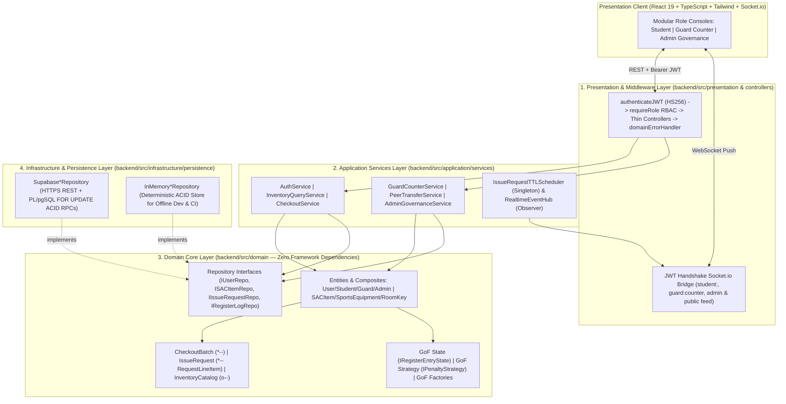

# SACPulse — Campus Activity Centre Digital Register & Real-Time Inventory Engine

**SACPulse** replaces the paper-bound entry ledger at the **IIIT Allahabad Student Activity Centre (SAC)** with a real-time, concurrency-safe equipment and room-key operations platform. Students check live equipment availability before walking across campus, submit time-bounded counter checkout requests, transfer held gear peer-to-peer via atomic ledger splits, and clear returns at the Guard Desk without paper bottlenecks.

---

## Core Operational Workflows

- **Privacy-Safe Live Campus Feed:** Students view real-time availability for multi-unit sports gear (`SportsEquipment`) and singleton activity room keys (`RoomKey`). Occupied rooms expose *"Occupied since HH:MM"* (and flag Faculty Sessions automatically) without leaking active student names or phone numbers.
- **Institutional Google OAuth & External Staff Whitelist:** `@iiita.ac.in` accounts auto-provision as `STUDENT` with parsed Roll Numbers and one-time Indian mobile verification. External staff (`@gmail.com`) authenticate only through a Root-Admin-governed whitelist (`GUARD` / `ADMIN` / `STUDENT`).
- **Authoritative 120-Second Counter Walk-Up TTL:** Checkout requests run on an authoritative server-clock timer (`IssueRequestTTLScheduler`) with boot-time crash recovery. Exceeding 3 timeouts within a sliding 1-hour window imposes an automatic 5-hour borrowing cooldown.
- **Batch Counter Issuance & Defaulter Governance:** Guard approval expands multi-unit bundles into individual physical unit rows (`RegisterEntry`) grouped under a shared `CheckoutBatch` (`batch_id`). Marking a returned unit `DAMAGED` permanently removes it from functional stock and locks the current holder as a `DEFAULTER` until cleared by an Administrator.
- **Atomic Peer-to-Peer (P2P) Transfers:** An active holder can transfer a single unit out of a multi-unit batch to an eligible peer by Roll Number. Acceptance executes an ACID row split (`RETURNED_VIA_TRANSFER` on Holder A + new `ISSUED` row on Holder B under the shared `batch_id`), while physical Guard Desk returns override any pending P2P offer immediately.

---

## 5-Layer Clean OOP Architecture



---

## Gang-of-Four (GoF) Design Patterns & OOP Principles

| Pattern / Principle | Category | Production Implementation | Purpose |
| :--- | :--- | :--- | :--- |
| **State Pattern** | Behavioral | `backend/src/domain/states/IRegisterEntryState.ts` (`IssuedState`, `TransferPendingState`, `ReturnedState`, `ReturnedViaTransferState`, `DamagedState`) | Encapsulates legal unit transitions, P2P locks, atomic transfer splits, and Guard Desk return overrides without status `if/else` chains. |
| **Template Method** | Behavioral | `backend/src/domain/entities/SACItem.ts` (`checkout()`, `checkin()`) | Defines invariant validation and post-mutation hooks while deferring polymorphic stock/occupancy rules to `SportsEquipment` and `RoomKey`. |
| **Strategy Pattern** | Behavioral | `backend/src/domain/strategies/IPenaltyStrategy.ts` (`SlidingWindowCooldownStrategy`, `StrictPeakHoursPenaltyStrategy`) + `IEligibilityRule.ts` | Allows runtime swapping of walk-up TTL windows, strike thresholds, and cooldown durations across `CheckoutService` and `IssueRequestTTLScheduler`. |
| **Factory Method** | Creational | `backend/src/domain/factories/SACItemFactory.ts`, `UserFactory.ts` | Centralizes polymorphic hydration of `SportsEquipment` vs `RoomKey` and `Student` vs `Guard` vs `Admin`. |
| **Observer + Singleton** | Behavioral / Creational | `backend/src/application/services/RealtimeEventHub.ts`, `IssueRequestTTLScheduler.ts` | Decouples domain mutations and server-clock TTL expirations from Socket.io transport channels. |
| **Repository (SOLID DIP)** | Architectural / SOLID | `backend/src/domain/repositories/*` implemented by `Supabase*Repository` & `InMemory*Repository` | Enables identical domain/service execution against live Supabase PostgreSQL or deterministic in-memory CI storage. |

---

## Security & Concurrency Model

1. **Signed HMAC-SHA256 Session JWTs (`JwtTokenService`):** All protected routes require `Authorization: Bearer <jwt>` verified via constant-time `crypto.timingSafeEqual`, role claim validation (`STUDENT | GUARD | ADMIN`), `requireRole(...)` RBAC, and horizontal IDOR ownership checks. In production (`NODE_ENV=production`), the server enforces a mandatory `JWT_SECRET` of at least 32 characters; in development/test, an ephemeral random secret is generated if unset so no static fallback key exists.
2. **Cryptographic Google OAuth & Strict Demo Allowlist:** `POST /api/auth/google` strictly verifies Google ID tokens via `google-auth-library` (`OAuth2Client.verifyIdToken`). Demo role-switcher sessions (`POST /api/auth/demo-session`) are disabled in production and restricted exclusively to the 5 seeded demo accounts (`DEFAULT_DEMO_ACCOUNT_EMAILS`) in non-production environments.
3. **JWT-Authenticated WebSocket Handshake & Private Room Isolation:** Clients authenticate the Socket.io handshake using `auth: { token }`. The server verifies the JWT and assigns connections to private channels (`student:<id>`, `guard:counter`, `admin`), ensuring student PII and operational queues are never leaked over global broadcasts.
4. **PostgreSQL Row-Level Locking (`SELECT ... FOR UPDATE`):** Multi-row stock allocations, atomic P2P splits, and Guard Desk returns execute inside transactional PL/pgSQL RPC functions (`backend/migrations/002_acid_rpc_functions.sql`) to prevent double-allocation and late-transfer race conditions.

---

## Quick Start

### 1. Prerequisites
- **Node.js** `>= 20.x`
- **Supabase PostgreSQL Project** (optional for local/offline mode — set `PERSISTENCE_DRIVER=memory` to run completely offline with seeded campus data)

### 2. Database Setup (Supabase Mode)
Execute the reproducible SQL migrations in your Supabase SQL Editor in order:
1. `backend/migrations/001_initial_schema.sql` (6 tables, constraints, indexes, RLS policies)
2. `backend/migrations/002_acid_rpc_functions.sql` (4 transactional ACID RPC functions)
3. Seed realistic campus data via `npm run seed --prefix backend` (or `backend/src/infrastructure/persistence/seed.sql`)

### 3. Environment Configuration

`backend/.env` (see `backend/.env.example`):
```env
PORT=5001
NODE_ENV=development
CORS_ORIGIN=http://localhost:5173
PERSISTENCE_DRIVER=supabase          # Set to 'memory' for 100% offline local mode
SUPABASE_URL=https://<project>.supabase.co
SUPABASE_SERVICE_ROLE_KEY=<service-role-key>
SUPABASE_ANON_KEY=<anon-key>
GOOGLE_CLIENT_ID=<google-oauth-client-id>
JWT_SECRET=<strong-random-32+-char-secret>
INITIAL_ADMIN_EMAIL=admin@iiita.ac.in
```

`frontend/.env` (see `frontend/.env.example`):
```env
VITE_GOOGLE_CLIENT_ID=<google-oauth-client-id>
# Optional for separate production deployment (e.g. Vercel frontend -> Render backend):
# VITE_API_URL=https://your-backend-service.onrender.com
# VITE_SOCKET_URL=https://your-backend-service.onrender.com
```

### 4. Install & Run

```bash
# Terminal 1 — Backend API & Socket.io Server (http://localhost:5001)
cd backend
npm install
npm run dev

# Terminal 2 — Frontend Vite Client (http://localhost:5173)
cd frontend
npm install
npm run dev
```

> **Viva / Evaluator Role Switching Shortcut:** In non-production builds (`NODE_ENV !== 'production'`), press `Ctrl+Shift+D` (`Cmd+Shift+D` on macOS) or open `http://localhost:5173/?demo=1` to toggle a discrete role-switcher bar (`Student A`, `Student B`, `Guard`, `Admin`) backed by signed JWT demo sessions (`POST /api/auth/demo-session`).

---

## Verification & Testing Suite

SACPulse ships with **85 automated tests across 11 suites** spanning Unit (GoF patterns, relationships, JWT security, timer recovery), API Contract, and Multi-Actor System Lifecycle + RBAC/IDOR security matrices:

```bash
# Fast deterministic offline/CI run (~0.7s, zero external network calls)
npm run test:memory --prefix backend

# Full suite including live Supabase PostgreSQL integration tests
npm test --prefix backend

# Strict TypeScript & Vite production builds
npm run build --prefix backend
npm run build --prefix frontend
```

---

## Production Deployment

1. **Backend (Render / Railway):**
   - Root Directory: `backend`
   - Build Command: `npm install && npm run build`
   - Start Command: `npm start`
   - Required Environment Variables: `NODE_ENV=production`, `JWT_SECRET` (minimum 32 characters), `CORS_ORIGIN` (comma-separated frontend origin(s) if multiple), `SUPABASE_URL`, `SUPABASE_SERVICE_ROLE_KEY`, `GOOGLE_CLIENT_ID`, and `INITIAL_ADMIN_EMAIL`.
2. **Frontend (Vercel / Netlify):**
   - Root Directory: `frontend`
   - Build Command: `npm run build`
   - Output Directory: `dist`
   - Required Environment Variables: `VITE_API_URL` (your deployed backend URL) and `VITE_GOOGLE_CLIENT_ID`.
3. **Google Cloud Console:**
   - Add your deployed frontend domain to **Authorized JavaScript origins** under your Google OAuth 2.0 Client ID.


