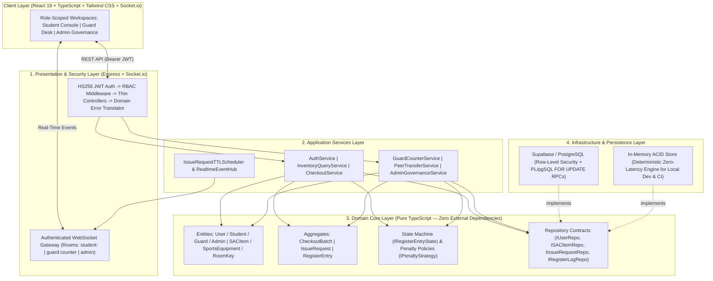

<div align="center">

# SACPulse

### Real-Time Asset Ledger, Concurrency-Safe Inventory & Peer-to-Peer Handoff Engine

[](https://www.typescriptlang.org/)
[](https://react.dev/)
[](https://nodejs.org/)
[](https://supabase.com/)
[](https://socket.io/)
[](#testing--quality-assurance)

**SACPulse** is a full-stack, event-driven inventory and digital register platform engineered for high-traffic Student Activity Centres (SAC). It replaces paper-bound equipment ledgers with live stock telemetry, server-authoritative reservation timers, row-locked ACID counter checkouts, and atomic peer-to-peer (P2P) asset transfers.

</div>

---

## Why SACPulse?

High-density campus recreation facilities process hundreds of daily checkouts across multi-unit sports gear and singleton activity rooms. Paper registers break down under peak load:

* **Blind Walk-Ups:** Students walk across campus without knowing whether courts, rooms, or equipment are in stock.
* **Counter Bottlenecks & Ghost Reservations:** Unclaimed requests tie up scarce inventory unless governed by strict, crash-recoverable server TTLs.
* **Untracked Peer Handoffs:** When students pass equipment to peers on the court, paper logs leave the original borrower liable for lost or damaged gear.
* **Privacy Exposure:** Paper ledgers and naive dashboards expose students' names and phone numbers publicly.

**SACPulse** solves these problems with a zero-trust, real-time state engine backed by PostgreSQL row-level locking (`SELECT ... FOR UPDATE`) and role-scoped WebSocket channels.

---

## Key Capabilities

### 1. Live Privacy-Safe Campus Telemetry
* Real-time availability feed for multi-unit equipment (`SportsEquipment`) and singleton room keys (`RoomKey`).
* Active rooms broadcast occupancy duration (*"Occupied since HH:MM"*) and Faculty/Event overrides without exposing student PII (names, roll numbers, or phone numbers) to the public feed.

### 2. Server-Authoritative 120s Walk-Up TTL & Abuse Cooldowns
* Checkout requests start an authoritative 120-second server countdown (`IssueRequestTTLScheduler`) with automatic boot-time crash recovery.
* **Sliding-Window Rate Limiting:** Accumulating 3 expired walk-up requests within a 1-hour sliding window automatically triggers a 5-hour borrowing cooldown.

### 3. Transactional Batch Issuance & Defaulter Governance
* Counter approval expands multi-item requests into unit-level ledger rows (`RegisterEntry`) grouped under a shared `CheckoutBatch` (`batch_id`).
* Returning a unit as **Intact** immediately restores functional stock; marking a unit **Damaged** permanently decrements available inventory and locks the holder as a `DEFAULTER` until cleared by an Administrator.

### 4. Atomic Peer-to-Peer (P2P) Ownership Splits
* Active holders can transfer individual units from a multi-unit batch to another eligible student by Roll Number.
* Acceptance executes an ACID transaction that closes the sender's ledger entry (`RETURNED_VIA_TRANSFER`) and opens a new `ISSUED` entry for the recipient under the original `batch_id`.
* Physical counter returns always take precedence, automatically voiding any in-flight P2P transfer offer.

### 5. Role-Based Consoles & External Staff Governance
* **Student Console:** Live catalog filtering, multi-item cart, real-time walk-up countdown, active holdings, and P2P transfer management.
* **Guard Counter Console:** Instant walk-up queue approval, unit/batch return processing, damage flagging, and faculty room overrides.
* **Admin Governance Console:** Paginated master register audit logs with RFC-4180 CSV export, inventory CRUD, defaulter/cooldown overrides, and hierarchical staff whitelist management.

---

## System Architecture

SACPulse follows a strict **5-Layer Clean Architecture** where the Domain Core has zero framework or database dependencies:



---

## Engineering Highlights

| Area | Implementation Details |
| :--- | :--- |
| **Database Concurrency & ACID RPCs** | Critical multi-row mutations (`approve_issue_request_tx`, `execute_transfer_split_tx`, `close_guard_return_tx`, `close_guard_batch_return_tx`) run inside PostgreSQL PL/pgSQL transactions using `SELECT ... FOR UPDATE` row-level locks to eliminate double-allocation and race conditions. |
| **Explicit Ledger State Machine** | Every issued unit (`RegisterEntry`) transitions through strongly typed state objects (`IssuedState`, `TransferPendingState`, `ReturnedState`, `ReturnedViaTransferState`, `DamagedState`), preventing illegal transitions at compile and runtime. |
| **Zero-Trust Auth & IDOR Protection** | Google OAuth 2.0 ID tokens are cryptographically verified via `google-auth-library`. Session JWTs use constant-time `crypto.timingSafeEqual` HMAC-SHA256 verification, strict RBAC middleware, and horizontal ownership checks to block IDOR across student profiles, holdings, and transfers. |
| **Private WebSocket Room Isolation** | Socket.io connections verify the Bearer JWT during the handshake and bind sockets to isolated rooms (`student:<id>`, `guard:counter`, `admin`), ensuring student contact details and queue updates are never broadcast to unauthorized clients. |
| **Pluggable Persistence Drivers** | Repository interfaces allow switching between **Supabase PostgreSQL** (`PERSISTENCE_DRIVER=supabase`) and a deterministic **In-Memory Store** (`PERSISTENCE_DRIVER=memory`) via a single environment variable. |

---

## Tech Stack

* **Frontend:** React 19, TypeScript 5.8, Vite 6, Tailwind CSS 3, Socket.io Client, Lucide Icons, `@react-oauth/google`
* **Backend:** Node.js 20+, Express 4, TypeScript (NodeNext ESM), Socket.io 4, `google-auth-library`
* **Database:** PostgreSQL (Supabase), PL/pgSQL Transactional RPCs, Row-Level Security (RLS)
* **Testing & CI:** Vitest (Unit, API Contract, and Multi-Actor System Lifecycle suites), GitHub Actions CI

---

## API Overview

| Method | Endpoint | Access | Description |
| :--- | :--- | :--- | :--- |
| `POST` | `/api/auth/google` | Public | Verify Google OAuth ID token and issue signed HS256 session JWT |
| `PATCH` | `/api/auth/mobile-setup` | Authenticated | Complete one-time 10-digit Indian mobile number verification |
| `POST` | `/api/auth/request-whitelist` | Public | Submit external staff/guest access request for Admin review |
| `GET` | `/api/inventory` | Public | Fetch live, privacy-safe equipment & room availability feed |
| `POST` | `/api/issue-requests` | `STUDENT` | Create a 120-second TTL walk-up checkout request |
| `GET` | `/api/issue-requests/my-pending` | `STUDENT` | Fetch active pending request for the authenticated student |
| `GET` | `/api/guard/requests/pending` | `GUARD`, `ADMIN` | List live walk-up queue at the SAC Counter |
| `POST` | `/api/guard/requests/:id/approve` | `GUARD`, `ADMIN` | Atomically lock stock and issue unit-level register entries |
| `POST` | `/api/guard/returns/:entryId/intact` | `GUARD`, `ADMIN` | Process intact single-unit return and restore stock |
| `POST` | `/api/guard/returns/batch/:batchId/intact` | `GUARD`, `ADMIN` | Return all remaining active units in a checkout batch |
| `POST` | `/api/guard/returns/:entryId/damaged` | `GUARD`, `ADMIN` | Mark unit damaged, decrement stock, and flag holder as Defaulter |
| `POST` | `/api/guard/rooms/:id/faculty-occupy` | `GUARD`, `ADMIN` | Override activity room key for a faculty/event session |
| `POST` | `/api/transfers/:entryId/initiate` | `STUDENT` | Initiate P2P transfer offer to a peer by Roll Number |
| `POST` | `/api/transfers/:entryId/respond` | `STUDENT` | Accept (atomic row split) or reject an incoming P2P transfer |
| `GET` | `/api/admin/register-logs` | `ADMIN` | Query paginated master ledger or export RFC-4180 CSV (`?format=csv`) |
| `POST` | `/api/admin/inventory` | `ADMIN` | Create or update SAC equipment and room catalog items |
| `POST` | `/api/admin/users/:id/clear-defaulter` | `ADMIN` | Clear student defaulter lock or reset timeout cooldown |
| `POST` | `/api/admin/whitelist/approve` | `ADMIN` | Approve external staff whitelist request (Root Admin for `ADMIN` role) |

---

## Project Structure

```text
SACPulse/
├── backend/
│   ├── migrations/
│   │   ├── 001_initial_schema.sql          # Tables, constraints, indexes & RLS policies
│   │   └── 002_acid_rpc_functions.sql      # PL/pgSQL FOR UPDATE transactional RPCs
│   ├── src/
│   │   ├── domain/                         # Entities, Aggregates, State Machine, Strategies & Interfaces
│   │   ├── application/services/           # Use-case orchestration, JWT service, TTL scheduler & EventHub
│   │   ├── infrastructure/persistence/     # Supabase & In-Memory repository implementations
│   │   ├── controllers/                    # Thin HTTP controllers
│   │   └── presentation/                   # Express app, routes, JWT/RBAC middleware & Socket.io server
│   └── tests/                              # 85 unit, API integration & multi-actor system tests
└── frontend/
    └── src/
        ├── components/
        │   ├── auth/                       # Google OAuth sign-in, mobile onboarding & access request UI
        │   ├── student/                    # Live catalog, walk-up tracker, holdings & P2P transfer modals
        │   ├── guard/                      # Live counter queue, active register, return & room controls
        │   └── admin/                      # Master audit log, CSV export, catalog CRUD & whitelist console
        └── services/                       # Typed REST client & JWT-authenticated Socket.io singleton
```

---

## Getting Started

### Prerequisites
* **Node.js** `>= 20.x`
* **Supabase Project** *(optional — set `PERSISTENCE_DRIVER=memory` to run 100% offline with pre-seeded data)*

### 1. Clone & Install Dependencies

```bash
git clone <your-repo-url>
cd SACPulse

cd backend && npm install
cd ../frontend && npm install
```

### 2. Configure Environment Variables

Copy the example environment files in both workspaces:

```bash
cp backend/.env.example backend/.env
cp frontend/.env.example frontend/.env
```

**`backend/.env`:**
```env
PORT=5001
NODE_ENV=development
CORS_ORIGIN=http://localhost:5173
PERSISTENCE_DRIVER=memory            # Use 'memory' for instant offline mode, or 'supabase' for PostgreSQL
SUPABASE_URL=https://<project>.supabase.co
SUPABASE_SERVICE_ROLE_KEY=<service-role-key>
SUPABASE_ANON_KEY=<anon-key>
GOOGLE_CLIENT_ID=<google-oauth-client-id>.apps.googleusercontent.com
JWT_SECRET=<at-least-32-character-random-secret>
INITIAL_ADMIN_EMAIL=admin@iiita.ac.in
```

**`frontend/.env`:**
```env
VITE_GOOGLE_CLIENT_ID=<google-oauth-client-id>.apps.googleusercontent.com
# Optional when deploying frontend and backend on separate hosts:
# VITE_API_URL=https://your-backend.onrender.com
# VITE_SOCKET_URL=https://your-backend.onrender.com
```

### 3. Database Setup (When Using `PERSISTENCE_DRIVER=supabase`)

Run the SQL migrations in the Supabase SQL Editor in order:
1. `backend/migrations/001_initial_schema.sql`
2. `backend/migrations/002_acid_rpc_functions.sql`
3. Seed initial data with `npm run seed --prefix backend`

### 4. Run Development Servers

```bash
# Terminal 1 — Backend API & WebSocket Server (http://localhost:5001)
npm run dev:backend

# Terminal 2 — Frontend Client (http://localhost:5173)
npm run dev:frontend
```

> **Local Role Switcher (Development Only):** Press `Ctrl+Shift+D` (`Cmd+Shift+D` on macOS) or append `?demo=1` to `http://localhost:5173/?demo=1` to toggle the local role-switcher (`Student A`, `Student B`, `Guard`, `Admin`) for testing multi-actor workflows side-by-side.

---

## Testing & Quality Assurance

SACPulse includes **85 automated tests across 11 suites** covering domain state machines, penalty strategies, JWT cryptography, TTL timer recovery, REST API contracts, and multi-actor RBAC/IDOR security boundaries:

```bash
# Run full test suite against the deterministic in-memory engine (~0.7s)
npm run test:memory --prefix backend

# Run integration tests against live Supabase PostgreSQL
npm test --prefix backend

# Verify production TypeScript & Vite builds
npm run build:backend
npm run build:frontend
```

---
