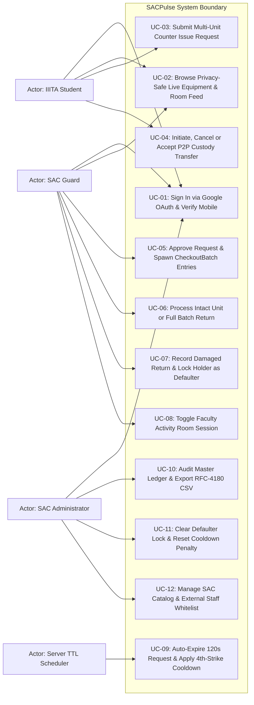
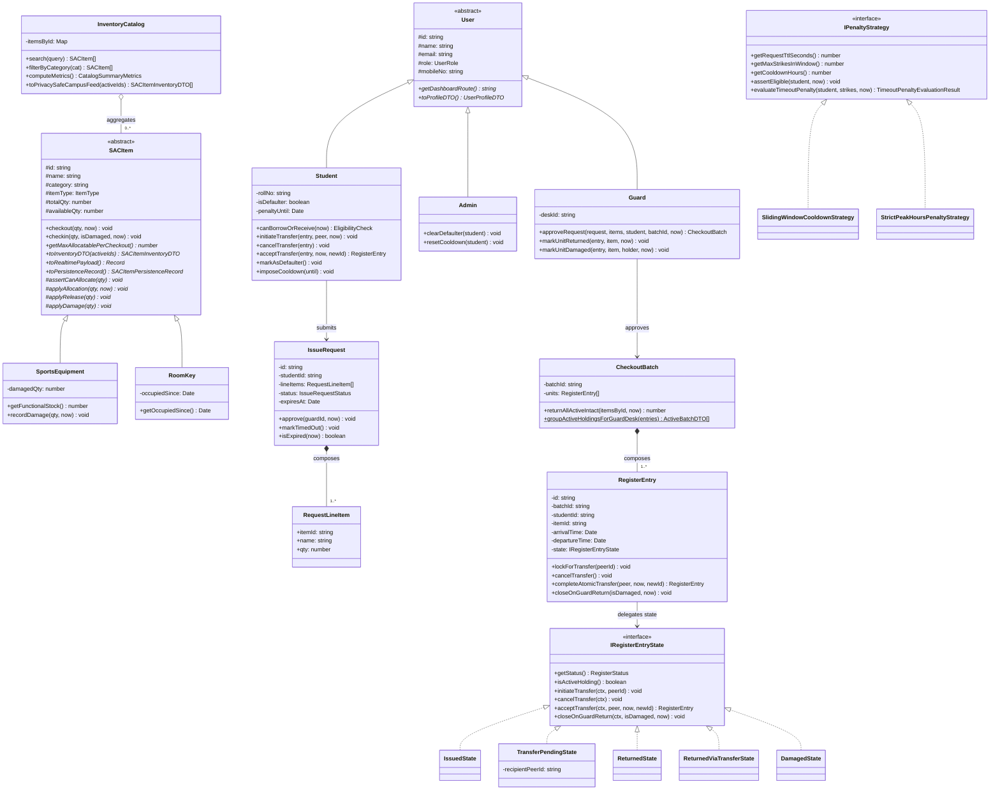
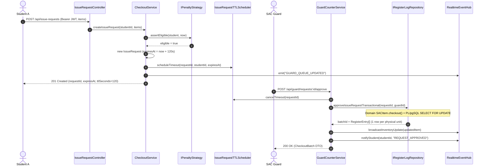
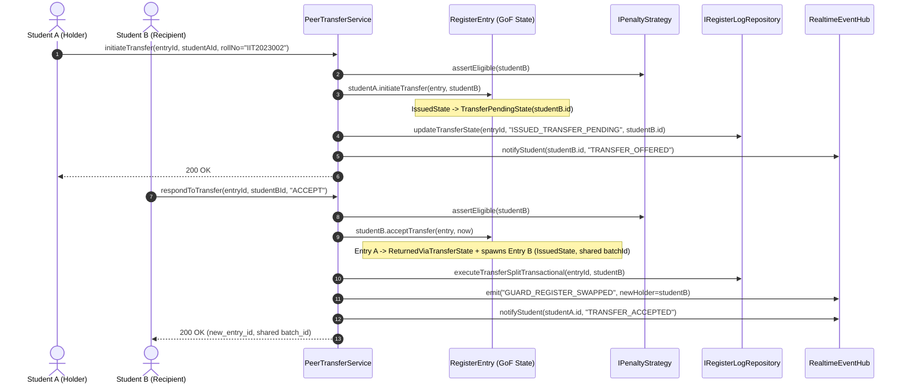
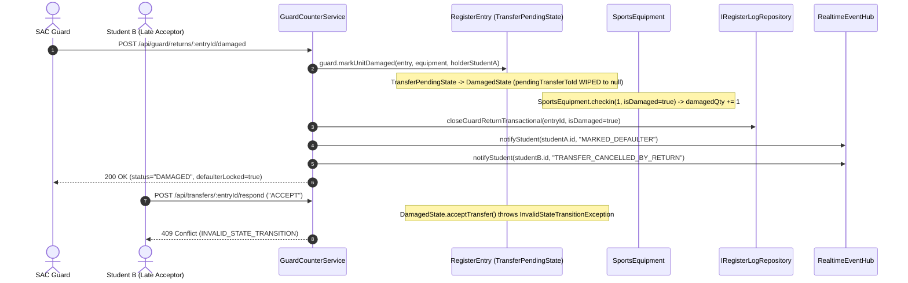
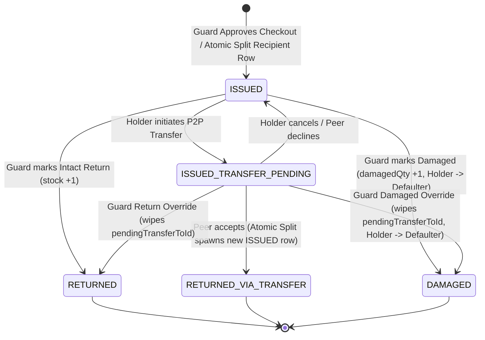
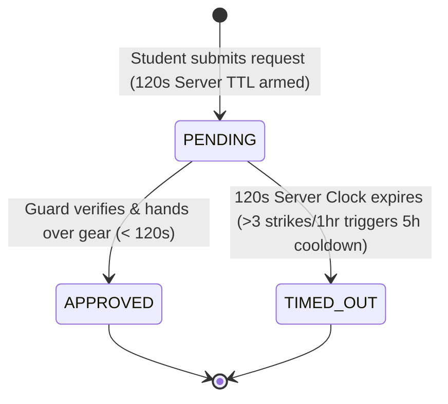
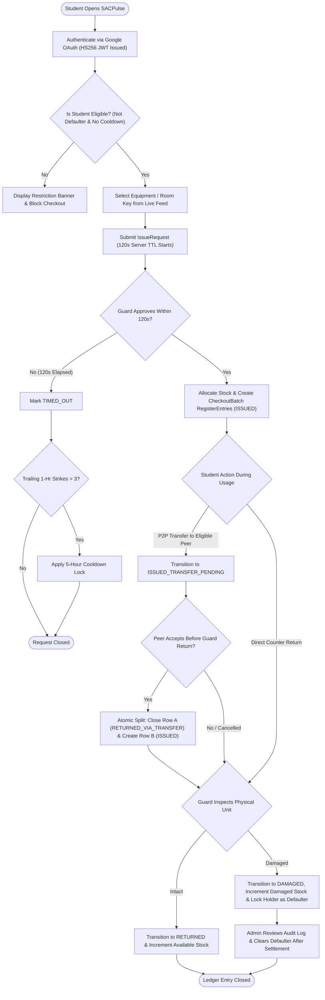

# SACPulse — Object-Oriented Methodology (OOM) Project Report

**Institution:** Indian Institute of Information Technology, Allahabad (IIITA)  
**Course:** Object-Oriented Methodology (Semester 3)  
**Project Title:** SACPulse — Real-Time Campus Activity Centre Digital Register & Object-Oriented Inventory Engine  
**Technology Stack:** TypeScript 5.8 (Strict OOP), Node.js / Express, Socket.io, React 19, PostgreSQL (Supabase)

### Group Members

| Member | Name | Roll Number | Primary OOM Subsystem Ownership |
| :---: | :--- | :--- | :--- |
| **1** | Harshit Sethi *(Update if needed)* | `IIT2024XXX` *(Fill Roll No)* | Core Domain Entities (`SACItem`, `RegisterEntry`, `CheckoutBatch`, `InventoryCatalog`), GoF State, Template Method & Factory Patterns |
| **2** | Group Member 2 *(Fill Name)* | `IIT2024XXX` *(Fill Roll No)* | Actor Hierarchy (`User`/`Student`/`Guard`/`Admin`), GoF Strategy & Observer/Singleton Patterns, 120s TTL & Atomic P2P Split |
| **3** | Group Member 3 *(Fill Name)* | `IIT2024XXX` *(Fill Roll No)* | `DomainException` Hierarchy, Repository DIP Interfaces & Dual Adapters (`Supabase` + `InMemory`), HS256 JWT Security & 85-Test OOP Suite |

---

## 1. Executive Summary & Real-World Problem Statement

At the **IIIT Allahabad Student Activity Centre (SAC)**, multi-unit sports equipment (Table Tennis rackets, balls, Lawn Tennis gear, Chess and Carrom sets) and singleton activity room keys (Dance Room, Music Room, Drama Room) are traditionally managed through a physical paper register at the guard counter. That manual paper process fails in four operational ways:

1. **Zero Pre-Walk Availability Visibility:** Students walk across campus without knowing whether equipment or activity rooms are currently free.
2. **Borrower Privacy Exposure:** Open paper registers expose every active borrower's full name, roll number, and 10-digit mobile number to anyone standing at the counter.
3. **Broken Custody Chain on Court Hand-Offs:** When Student A informally hands a racket to Student B on the court, Student A remains liable on paper if Student B damages or loses the item.
4. **Counter Bottlenecks & Ghost Reservations:** Without an authoritative walk-up expiration timer and anti-spam cooldown policy, remote reservations stall physical counter operations.

**SACPulse** solves these challenges through a **5-Layer Clean Object-Oriented Architecture** where rich domain classes, explicit inter-class relationships (**Composition**, **Aggregation**, **Association**), **SOLID design principles**, **6 Gang-of-Four (GoF) / Architectural Design Patterns**, and a **9-class OOP Exception Hierarchy** execute directly on the production request path.

---

## 2. Core Object-Oriented Concepts in Production Code

### 2.1 Classes, Objects, Constructors, Attributes & Access Modifiers

Every domain concept in `backend/src/domain/` is modeled as a rich class with strict `private` or `protected` attributes, constructor invariant checks, and behavioral methods (zero anemic public-property data bags):

| Class (`backend/src/domain/`) | Encapsulated Attributes & Modifiers | Constructor Invariants Enforced | Key Behavioral Methods |
| :--- | :--- | :--- | :--- |
| `SACItem` (`abstract`) | `protected readonly id, itemType`; `protected name, category, totalQty, availableQty, lastMutatedAt` | Non-empty `id`/`name`/`category`; `totalQty >= 0`; `availableQty <= totalQty` | `checkout()`, `checkin()`, `isAvailable()`, `toInventoryDTO()`, `toPersistenceRecord()` |
| `SportsEquipment` | `private damagedQty: number` | `damagedQty >= 0`; `availableQty + damagedQty <= totalQty` | `getFunctionalStock()`, `recordDamage()`, `applyAllocation()`, `applyRelease()` |
| `RoomKey` | `private occupiedSince: Date \| null` | Enforces singleton room key (`totalQty === 1`) | `getOccupiedSince()`, privacy-safe `toInventoryDTO()` with `isFacultySession` derivation |
| `RegisterEntry` | `private state: IRegisterEntryState`; `private departureTime: Date \| null`; `private readonly batchId, studentId, itemId` | Valid holder identity, item identity, and hydrated `IRegisterEntryState` | `lockForTransfer()`, `cancelTransfer()`, `completeAtomicTransfer()`, `closeOnGuardReturn()` |
| `CheckoutBatch` | `private readonly batchId: string`; `private readonly units: RegisterEntry[]` | Non-empty `units`; every `RegisterEntry` must match `batchId` | `returnAllActiveIntact()`, `groupActiveHoldingsForGuardDesk()` |
| `IssueRequest` | `private readonly lineItems: RequestLineItem[]`; `private status`; `private approvedById` | At least 1 `RequestLineItem`; positive integer `qty`; server-calculated `expiresAt` | `approve()`, `markTimedOut()`, `isExpired()`, `getTotalRequestedUnits()` |
| `User` (`abstract`) / `Student` / `Guard` / `Admin` | `protected readonly id, email, role`; `private rollNo, isDefaulter, penaltyUntil` on `Student` | Normalized institutional email, valid role, derived Roll Number | `canBorrowOrReceive()`, `initiateTransfer()`, `acceptTransfer()`, `approveRequest()`, `clearDefaulter()` |

---

### 2.2 The Four Pillars of Object-Oriented Programming

#### 1. Encapsulation
- **Damaged vs. Functional Stock Protection (`SportsEquipment`):** External layers cannot directly mutate `availableQty` or `damagedQty`. Returning a broken racket invokes `checkin(1, true)`, which increments `damagedQty` while keeping `availableQty` unchanged so damaged gear never re-enters available stock. Releasing more units than `totalQty - damagedQty` throws `InvalidStateTransitionException`.
- **Defensive Collection Cloning (`CheckoutBatch`, `IssueRequest`):** `CheckoutBatch.getUnits()` and `IssueRequest.getLineItems()` return shallow clones (`[...this.units]`), preventing callers from mutating internal arrays outside domain methods.
- **Cryptographic Secret Encapsulation (`JwtTokenService`):** Signing keys and constant-time HMAC-SHA256 verification (`crypto.timingSafeEqual`) are encapsulated privately within `JwtTokenService`.

#### 2. Abstraction
- **Abstract Base Classes:** `SACItem`, `User`, `TerminalRegisterState`, `DomainException`, and `BaseController` capture shared contracts and invariant workflows while hiding concrete subtype storage details.
- **Behavioral & Persistence Interfaces:** `IRegisterEntryState`, `IPenaltyStrategy`, `IEligibilityRule`, `IGoogleTokenVerifier`, `IUserRepository`, `ISACItemRepository`, `IIssueRequestRepository`, and `IRegisterLogRepository` decouple use-case orchestration from low-level mechanisms.

#### 3. Inheritance
SACPulse organizes domain behavior across four Liskov-compliant inheritance hierarchies:
1. **Inventory Asset Hierarchy:** `SACItem` → `SportsEquipment` | `RoomKey`
2. **Campus Actor Hierarchy:** `User` → `Student` | `Guard` | `Admin`
3. **Terminal Ledger State Hierarchy:** `TerminalRegisterState` → `ReturnedState` | `ReturnedViaTransferState` | `DamagedState`
4. **Exception Hierarchy:** `DomainException` → 9 specialized exception subclasses (`ValidationException`, `AuthenticationException`, `AccessRestrictedException`, `UnauthorizedRoleException`, `IneligibleBorrowerException`, `EntityNotFoundException`, `InsufficientStockException`, `InvalidStateTransitionException`, `RequestExpiredException`).

#### 4. Polymorphism
- **Zero-`instanceof` Inventory Projections & Persistence:** `InventoryCatalog`, `SupabaseSACItemRepository`, and `RealtimeEventHub` operate on heterogeneous `SACItem[]` collections polymorphically without checking `item instanceof RoomKey`:
  ```typescript
  // InventoryCatalog.ts — Polymorphic campus feed across SportsEquipment & RoomKey
  public toPrivacySafeCampusFeed(activeHolderItemIds: ReadonlySet<string>): SACItemInventoryDTO[] {
    return this.getAll().map((item) => item.toInventoryDTO(activeHolderItemIds));
  }

  // SupabaseSACItemRepository.ts — Polymorphic persistence serialization
  public async save(item: SACItem): Promise<void> {
    const record = item.toPersistenceRecord();
    await supabase.from('sac_items').upsert(record, { onConflict: 'id' });
  }
  ```
- **Polymorphic Actor Routing & DTOs:** `AuthService` invokes `user.toProfileDTO()` and `user.getDashboardRoute()` on `User` references (`Student` projects roll number + restriction flags and routes to `'/student'`; `Guard` routes to `'/guard'`; `Admin` routes to `'/admin'`).

---

## 3. Relationships Between Classes: Association, Aggregation & Composition

| Relationship | UML Symbol | Participating Classes | Lifecycle & Ownership Proof in Codebase |
| :--- | :---: | :--- | :--- |
| **Composition** | `*--` | `IssueRequest *-- "1..*" RequestLineItem` | `IssueRequest` instantiates immutable `RequestLineItem` value objects inside its constructor (`IssueRequest.ts`). Line items have no independent identity or lifecycle outside their owning `IssueRequest`. |
| **Composition** | `*--` | `CheckoutBatch *-- "1..*" RegisterEntry` | Approving a multi-unit bundle creates physical `RegisterEntry` units bound to one `CheckoutBatch` (`CheckoutBatch.ts`), enabling composite operations like `returnAllActiveIntact()`. |
| **Aggregation** | `o--` | `InventoryCatalog o-- "0..*" SACItem` | `SACItem` entities persist independently in `ISACItemRepository`. `InventoryCatalog` (`InventoryCatalog.ts`) aggregates `SACItem` references for search, category filtering, and metrics; destroying the catalog leaves the `SACItem` objects alive. |
| **Association** | `-->` | `Student --> IssueRequest`, `Guard --> CheckoutBatch`, `CheckoutService --> IPenaltyStrategy` | Collaborating domain objects interact through method parameters or injected references without owning each other's lifecycles. |

---

## 4. SOLID Object-Oriented Design Principles

1. **Single Responsibility Principle (SRP):**
   - `RegisterEntry` manages unit custody state transitions; `CsvExportFormatter` (`CsvExportFormatter.ts`) handles RFC-4180 CSV formatting; `JwtTokenService` handles HS256 token signing; thin controllers (`src/controllers/*`) parse HTTP payloads while Application Services (`src/application/services/*`) orchestrate domain workflows. On the frontend, monolithic dashboards were split into 17 focused single-purpose components.
2. **Open/Closed Principle (OCP):**
   - Introducing a new asset subtype (e.g., `TournamentKit extends SACItem`) or a new cooldown policy (`StrictPeakHoursPenaltyStrategy implements IPenaltyStrategy`) requires **zero modifications** to `CheckoutService`, `InventoryQueryService`, or `IssueRequestTTLScheduler`.
3. **Liskov Substitution Principle (LSP):**
   - Both `SportsEquipment` and `RoomKey` honor `SACItem.checkout(qty, now)` and `SACItem.checkin(qty, isDamaged, now)` contracts and advertise capacity via `getMaxAllocatablePerCheckout()`, substituting seamlessly inside `CheckoutBatch.returnAllActiveIntact()`.
4. **Interface Segregation Principle (ISP):**
   - Repository contracts are split into 4 focused domain interfaces (`IUserRepository`, `ISACItemRepository`, `IIssueRequestRepository`, `IRegisterLogRepository`), and `IssueRequestTTLScheduler` depends only on the narrow 5-method `ITTLPersistenceDelegate` interface.
5. **Dependency Inversion Principle (DIP):**
   - All 6 Application Services depend exclusively on abstract interfaces in `src/domain/repositories/` and `src/domain/strategies/`. Concrete persistence drivers (`Supabase*Repository` vs `InMemory*Repository`) are injected at composition root (`src/presentation/routes.ts`).

---

## 5. Gang-of-Four (GoF) & Architectural Design Patterns

### 5.1 GoF State Pattern (`IRegisterEntryState`)
- **Context & Problem:** A checked-out unit (`RegisterEntry`) moves across 5 states (`ISSUED`, `ISSUED_TRANSFER_PENDING`, `RETURNED`, `RETURNED_VIA_TRANSFER`, `DAMAGED`) with strict rules: e.g., a physical Guard Desk return must override and wipe a pending P2P transfer, while terminal states must reject all further mutations with `409 Conflict`.
- **Implementation (`src/domain/states/IRegisterEntryState.ts`):** `RegisterEntry` delegates `lockForTransfer()`, `cancelTransfer()`, `completeAtomicTransfer()`, and `closeOnGuardReturn()` to concrete state objects (`IssuedState`, `TransferPendingState`, `ReturnedState`, `ReturnedViaTransferState`, `DamagedState`), eliminating sprawling `switch (status)` conditionals.

### 5.2 GoF Template Method Pattern (`SACItem.checkout` & `SACItem.checkin`)
- **Context & Problem:** Checking out or returning `SportsEquipment` vs `RoomKey` follows an identical invariant algorithm skeleton (positive integer validation → availability/occupancy assertion → subtype state mutation → `lastMutatedAt` audit hook).
- **Implementation (`src/domain/entities/SACItem.ts`):** `SACItem` implements concrete template methods `checkout()` and `checkin()` that call `protected abstract` primitive operations (`assertCanAllocate`, `applyAllocation`, `applyRelease`, `applyDamage`) overridden by `SportsEquipment` and `RoomKey`.

### 5.3 GoF Strategy Pattern (`IPenaltyStrategy` & `IEligibilityRule`)
- **Context & Problem:** Walk-up counter TTL windows and timeout strike penalties vary between regular semester hours (120s TTL, >3 strikes in 1 hr → 5h cooldown) and high-congestion tournament evenings (90s TTL, >1 strike in 1 hr → 12h cooldown).
- **Implementation (`src/domain/strategies/IPenaltyStrategy.ts`):** `SlidingWindowCooldownStrategy` and `StrictPeakHoursPenaltyStrategy` implement `IPenaltyStrategy` (composed with `NotDefaulterEligibilityRule` and `NoActiveCooldownEligibilityRule`) and can be swapped at runtime.

### 5.4 GoF Factory Method Pattern (`SACItemFactory` & `UserFactory`)
- **Context & Problem:** Persistence records and admin payloads carry string discriminators (`item_type: 'EQUIPMENT' | 'ROOM_KEY'`, `role: 'STUDENT' | 'GUARD' | 'ADMIN'`).
- **Implementation (`src/domain/factories/`):** `SACItemFactory` and `UserFactory` centralize discriminator validation and polymorphic entity construction.

### 5.5 GoF Observer + Singleton Pattern (`RealtimeEventHub` & `IssueRequestTTLScheduler`)
- **Context & Problem:** Domain mutations and asynchronous 120s server timer expirations must push live WebSocket updates to campus clients without coupling domain services to Socket.io.
- **Implementation (`src/application/services/`):** Services emit domain events (`inventory:updated`, `GUARD_QUEUE_UPDATED`, `GUARD_REGISTER_SWAPPED`, `STUDENT_NOTIFICATION`) on `RealtimeEventHub`, while `server.ts` subscribes as an Observer and bridges notifications to Socket.io rooms (`student:<id>`).

### 5.6 Repository Pattern (`src/domain/repositories/*`)
- **Context & Problem:** Business logic must execute identically against ACID PostgreSQL RPCs in cloud deployment and deterministic in-memory storage during offline development and CI.
- **Implementation (`src/infrastructure/persistence/`):** Interchangeable `Supabase*Repository` and `InMemory*Repository` adapters satisfy all 4 repository interfaces.

---

## 6. Exception Handling, Modularity & Maintainable Design

### 6.1 Polymorphic `DomainException` Hierarchy
All domain and application errors inherit from `abstract class DomainException extends Error` (`src/domain/exceptions/DomainException.ts`), encapsulating `statusCode`, `code`, and structured `details`. The centralized Express middleware (`src/presentation/middleware/errorHandler.ts`) catches `DomainException` polymorphically:

- `ValidationException` → `400 VALIDATION_ERROR`
- `AuthenticationException` → `401 AUTHENTICATION_ERROR`
- `AccessRestrictedException` / `UnauthorizedRoleException` / `IneligibleBorrowerException` → `403`
- `EntityNotFoundException` → `404 ENTITY_NOT_FOUND`
- `InsufficientStockException` / `InvalidStateTransitionException` / `RequestExpiredException` → `409`

### 6.2 Strict Modular Package Structure
```text
backend/src/
├── domain/           # Pure OOP Core (zero Express / Socket.io / Supabase imports)
│   ├── entities/     # SACItem, RegisterEntry, CheckoutBatch, InventoryCatalog, IssueRequest, User
│   ├── states/       # GoF State Pattern (IRegisterEntryState + 5 concrete states)
│   ├── strategies/   # GoF Strategy Pattern (IPenaltyStrategy, IEligibilityRule)
│   ├── factories/    # GoF Factory Method Pattern (SACItemFactory, UserFactory)
│   ├── repositories/ # Abstract DIP Repository Interfaces
│   └── exceptions/   # DomainException Hierarchy (9 concrete exception classes)
├── application/      # Use-Case Application Services, JwtTokenService, TTLScheduler, EventHub
├── infrastructure/   # Supabase*Repository (ACID RPCs) & InMemory*Repository Adapters
├── controllers/      # Thin HTTP Controllers extending BaseController
└── presentation/     # JWT/RBAC Middleware, domainErrorHandler, Express App & Socket.io Bridge
```

---

## 7. Unified Modeling Language (UML) Diagrams

### 7.1 UML Use-Case Diagram



---

### 7.2 Complete UML Class Diagram



---

### 7.3 UML Sequence Diagram A: Checkout Request, 120s TTL & Guard Batch Approval



---

### 7.4 UML Sequence Diagram B: Peer-to-Peer (P2P) Atomic Row Split



---

### 7.5 UML Sequence Diagram C: Guard Damaged Return Overriding Pending P2P Transfer



---

### 7.6 UML Statechart Diagrams

#### `RegisterEntry` GoF State Machine


#### `IssueRequest` Counter Walk-Up Lifecycle


---

### 7.7 UML Activity Diagram: End-to-End Equipment Custody Workflow



---

## 8. Automated Object-Oriented Verification Suite (85 / 85 Passing)

| Test Suite (`backend/tests/`) | Tests | Object-Oriented Concepts Verified | Result |
| :--- | :---: | :--- | :---: |
| `unit/gofPatternsAndSecurity.test.ts` | 10 | All 9 `DomainException` classes, all 5 `IRegisterEntryState` classes, `SACItem` Template Method & polymorphism, runtime `IPenaltyStrategy` swapping, `SACItemFactory` & `UserFactory`, `CheckoutBatch` & `IssueRequest` Composition (`*--`), `InventoryCatalog` Aggregation (`o--`), HS256 JWT tamper checks, boot TTL recovery. | **10 / 10 PASS** |
| `domain/SACItem.test.ts` | 13 | `SportsEquipment` & `RoomKey` inheritance, encapsulation of `damagedQty` vs `availableQty`, polymorphic `allocateUnit()` / `releaseUnit()`. | **13 / 13 PASS** |
| `domain/RegisterEntryTransfer.test.ts` | 7 | `RegisterEntry` state transitions, self-transfer guard, atomic P2P split invariants. | **7 / 7 PASS** |
| `domain/CloseOnGuardReturn.test.ts` | 3 | Guard return overriding pending P2P transfer, defaulter locking, `Admin.clearDefaulter()`. | **3 / 3 PASS** |
| `domain/PenaltyPolicy.test.ts` | 4 | Sliding-window 4th-strike 5-hour cooldown calculation & automatic expiry restoration. | **4 / 4 PASS** |
| `services/IssueRequestTTLScheduler.test.ts` | 4 | Singleton + Observer timer expiration, cancellation on approval, strike penalty delegation. | **4 / 4 PASS** |
| `api/*.test.ts` & `system/*.test.ts` | 44 | End-to-end Repository DIP parity across `InMemory*Repository` (0.76s CI) & `Supabase*Repository` (live PostgreSQL) + RBAC/IDOR security matrix. | **44 / 44 PASS** |
| **Total Verification Suite** | **85** | **11 Vitest Suites — 100% Automated Pass Rate** | **85 / 85 PASS** |

