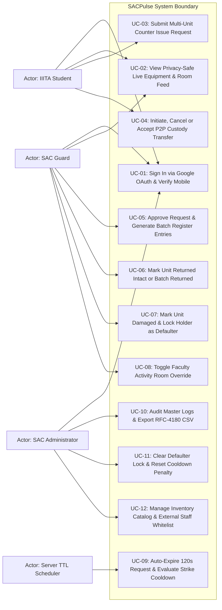
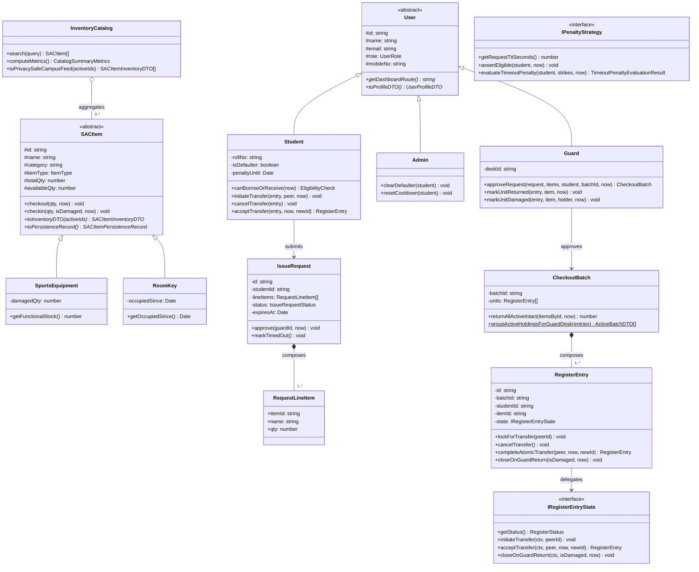
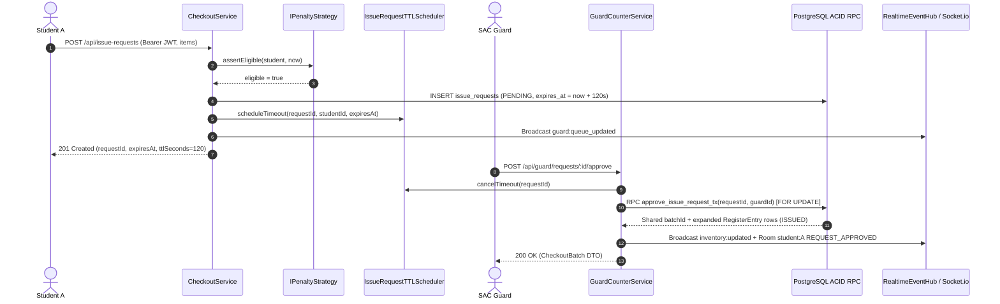
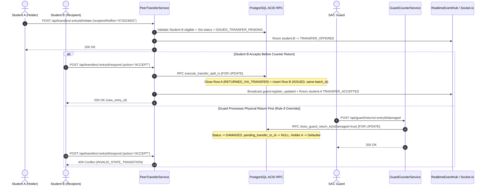
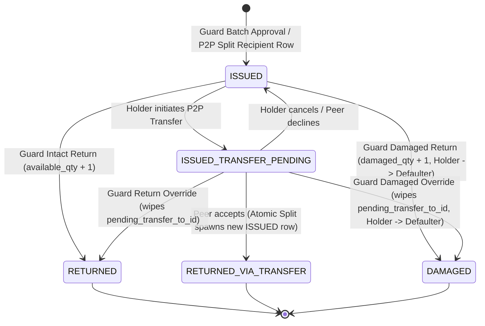
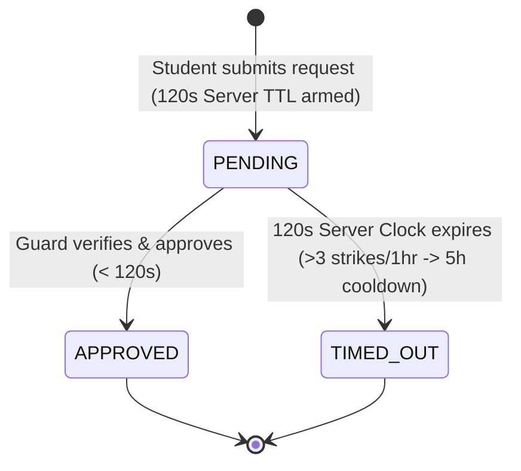
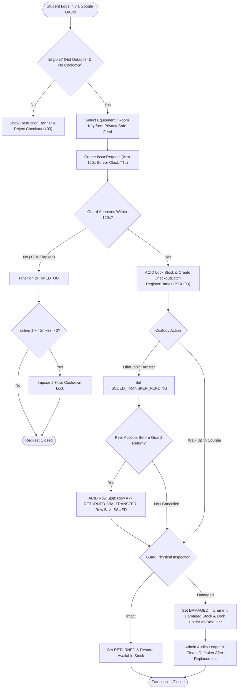
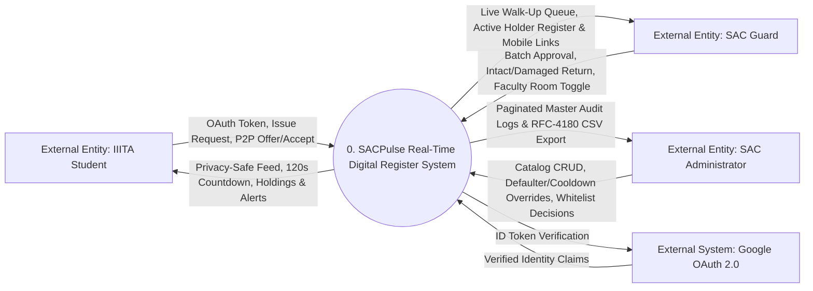
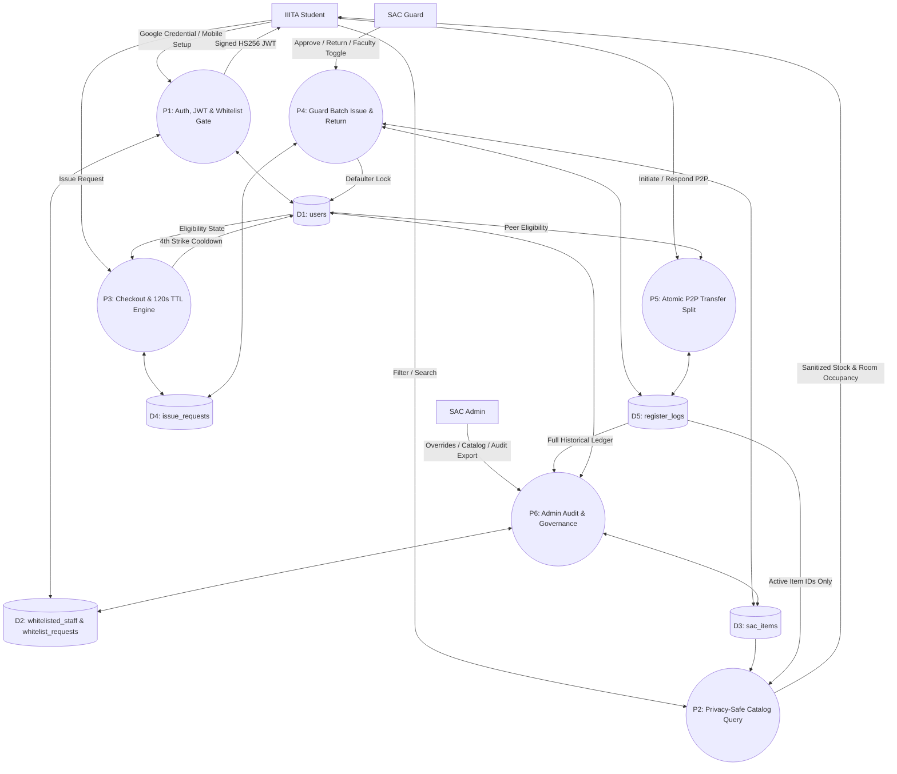
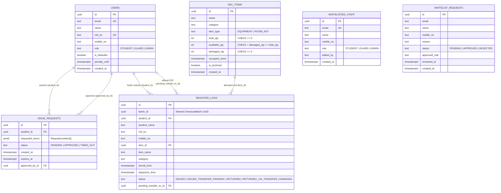

# SACPulse — Software Engineering (SE) Project Report & IEEE-830 SRS

**Institution:** Indian Institute of Information Technology, Allahabad (IIITA)  
**Course:** Software Engineering (Semester 3)  
**Project Title:** SACPulse — Real-Time Campus Activity Centre Digital Register & Concurrency-Safe Inventory Engine  
**Document Standard:** IEEE Std 830 / ISO/IEC/IEEE 29148 Software Requirements Specification & Full-SDLC Engineering Dossier

### Group Members

| Member | Name | Roll Number | Primary SE Lifecycle & Module Responsibility |
| :---: | :--- | :--- | :--- |
| **1** | Harshit Sethi *(Update if needed)* | `IIT2024XXX` *(Fill Roll No)* | System Architecture, Core Domain & Guard Counter Module, UML Class/State Modelling, Counter Integration Testing |
| **2** | Group Member 2 *(Fill Name)* | `IIT2024XXX` *(Fill Roll No)* | Requirement Analysis, 120s Authoritative TTL Engine, Atomic P2P Custody Split, Real-Time WebSockets & Student UI |
| **3** | Group Member 3 *(Fill Name)* | `IIT2024XXX` *(Fill Roll No)* | IEEE-830 SRS, PostgreSQL Schema & ACID `FOR UPDATE` RPCs, HS256 JWT/RBAC Security, 3-Tier Testing Suite, CI/CD & Admin UI |

---

## 1. Introduction, Scope Definition & SDLC Process Model

### 1.1 Real-World Problem Statement
At the **IIIT Allahabad Student Activity Centre (SAC)**, sports equipment (Table Tennis rackets, balls, Lawn Tennis gear, Chess/Carrom sets) and singleton activity room keys (Dance Room, Music Room, Drama Room) are logged manually in a physical paper register at the security desk. This creates four operational problems:
1. **Zero Pre-Walk Stock Visibility:** Students walk across campus blindly only to find all equipment issued or activity rooms occupied.
2. **Privacy Leakage on Paper Ledgers:** Open paper registers publicly expose active student names, roll numbers, and 10-digit mobile numbers.
3. **Unaccountable Informal Court Hand-Offs:** When Student A hands equipment to Student B on the court without counter re-registration, Student A remains liable on paper if Student B damages or loses the item.
4. **Counter Queue Congestion & Ghost Reservations:** Unbounded remote bookings stall physical walk-up students unless governed by an authoritative server countdown and anti-spam cooldown policy.

### 1.2 Project Scope Boundaries (In-Scope vs. Out-of-Scope)
To deliver a reliable, high-assurance system within the semester schedule without scope creep:
- **In-Scope:**
  - Institutional Google OAuth 2.0 login (`@iiita.ac.in` auto-provisioning + Root-Admin-governed external staff whitelist) and mandatory Indian mobile onboarding.
  - Privacy-safe live campus inventory & activity room occupancy feed (distinguishing Student Checkouts vs. Faculty Sessions without leaking borrower PII).
  - Authoritative 120-second server-clock walk-up checkout requests with boot-time crash recovery and sliding-window 4th-strike 5-hour cooldown penalties.
  - ACID row-locked Guard Counter batch issuance, intact unit/batch returns, damaged return defaulter locking, and physical counter override of pending P2P transfers.
  - Atomic peer-to-peer (P2P) custody transfer row splitting under a shared `batch_id`, real-time Socket.io notifications, paginated Admin Master Audit logs, and RFC-4180 CSV export.
- **Explicitly Out-of-Scope:**
  - Advance multi-day calendar slot booking (SAC operates strictly on live physical walk-up availability), online monetary fine payment gateways (defaulter clearance is verified offline by SAC Administration), and hardware RFID turnstiles.

### 1.3 Chosen SDLC Model: Iterative & Incremental Lifecycle
SACPulse was engineered across **four structured increments** under an **Iterative & Incremental SDLC** rather than a rigid Waterfall sequence:

| Increment | SDLC Phase Focus | Engineering Deliverables | Verification Gate |
| :--- | :--- | :--- | :--- |
| **Increment 1** | Requirements, Relational Schema & Domain Core | Stakeholder analysis, IEEE-830 SRS baseline, 6-table PostgreSQL schema (`001_initial_schema.sql`), core domain entities (`SACItem`, `RegisterEntry`, `User`). | 20 Domain Unit Tests passing. |
| **Increment 2** | Concurrency Engine, 120s TTL & Atomic P2P Split | 4 PL/pgSQL `SELECT ... FOR UPDATE` ACID RPCs (`002_acid_rpc_functions.sql`), `IssueRequestTTLScheduler` + boot crash recovery, atomic P2P row split. | Timer, Transfer & Guard Override tests passing. |
| **Increment 3** | Zero-Trust Security, Whitelist Governance & WebSockets | Cryptographic Google OAuth verification, `JwtTokenService` (HS256), `authenticateJWT`/`requireRole` RBAC, Root-Admin whitelist hierarchy, Socket.io room bridge. | Auth, Whitelist & RBAC/IDOR security suites passing. |
| **Increment 4** | Modular Role Consoles, Dual-Repository CI & SQA | Decomposed React 19 consoles (`Student`, `Guard`, `Admin`), `InMemory*Repository` offline/CI adapter, 85-test 3-tier suite, GitHub Actions CI (`ci.yml`). | **85/85 automated tests** & production builds passing. |

---

## 2. Requirement Analysis: Stakeholders & Use-Case Specifications

### 2.1 Stakeholder & User Class Analysis

| User Class / Stakeholder | Authentication Path | Key Operational Needs & Authority |
| :--- | :--- | :--- |
| **IIITA Student (`STUDENT`)** | Verified `@iiita.ac.in` Google ID token (uppercase Roll No parsed automatically) + 10-digit Indian mobile verification | View live gear/room availability, submit 120s walk-up checkout requests, initiate/cancel/accept P2P transfers, track active holdings and restriction alerts. |
| **SAC Counter Guard (`GUARD`)** | External Google account approved in `whitelisted_staff` (`role = 'GUARD'`) | Verify student walk-ups within 120s, approve multi-unit batches, inspect physical returns (`Intact` vs. `Damaged`), toggle Faculty Activity Room occupancy, call overdue holders via `tel:` links. |
| **SAC Administrator (`ADMIN`)** | Institutional Root Admin (`INITIAL_ADMIN_EMAIL`) or Root-delegated `ADMIN` | Audit paginated Master Register logs, export RFC-4180 CSV reports, clear defaulter locks, reset 5-hour cooldowns, manage SAC catalog items, approve/revoke external staff access. |
| **External Visiting Staff** | Self-service Whitelist Request modal on Login Page | Submit access request (`mobileNo` + reason) and check `PENDING` / `APPROVED` / `REJECTED` status without accessing internal endpoints. |

---

### 2.2 Structured Use-Case Specifications

| Use-Case ID & Name | Primary Actor | Preconditions | Main Success Scenario | Exception / Alternate Flows | Postconditions |
| :--- | :--- | :--- | :--- | :--- | :--- |
| **UC-01: Institutional Auth & Mobile Setup** | Student / Staff | Valid Google account | 1. Client submits Google OAuth ID token. 2. `AuthService` verifies token signature via Google OAuth2Client. 3. `@iiita.ac.in` user auto-provisioned as `STUDENT` with parsed Roll No; HS256 JWT issued. 4. First-time student submits 10-digit Indian mobile number. | **E1:** Non-IIITA email not in `whitelisted_staff` → `403 ACCESS_RESTRICTED` (prompts Whitelist Request modal). **E2:** Invalid mobile format → `400 VALIDATION_ERROR`. | Signed HS256 JWT active; `mobile_no` persisted. |
| **UC-03: Submit 120s Walk-Up Issue Request** | Student | Authenticated `STUDENT`, verified mobile, not Defaulter, no active Cooldown | 1. Student selects items (`qty >= 1` for equipment, `qty = 1` for room key). 2. `CheckoutService` validates eligibility via `IPenaltyStrategy`. 3. `IssueRequest` persisted (`expires_at = NOW() + 120s`) and server timer armed. 4. Guard Queue updated via WebSocket. | **E1:** Student is Defaulter or on Cooldown → `403 INELIGIBLE_BORROWER`. **E2:** Guard does not approve within 120s → status becomes `TIMED_OUT`; if >3 strikes in 1 hr, 5h cooldown applied. | `PENDING` request active on Guard Desk with authoritative 120s countdown. |
| **UC-05: Guard Atomic Batch Approval** | SAC Guard | Authenticated `GUARD`/`ADMIN`; request is `PENDING` and `expires_at > NOW()` | 1. Guard clicks **Approve** at counter. 2. `approve_issue_request_tx` locks request and requested `sac_items` rows `FOR UPDATE`. 3. Stock decremented (`occupied_since` stamped for `ROOM_KEY`); 1 `register_logs` row inserted per physical unit under shared `batch_id`. 4. 120s timer cancelled; live feed & student notified. | **E1:** Request expired (`expires_at <= NOW()`) → `409 REQUEST_EXPIRED`. **E2:** Concurrent approval exhausted stock → transaction rolls back, `409 INSUFFICIENT_STOCK`. | Physical units recorded in `ISSUED` state under one `CheckoutBatch`. |
| **UC-04: Atomic P2P Custody Transfer** | Student A & Student B | Student A holds `ISSUED` unit; Student B is an eligible `STUDENT` | 1. Student A enters Student B's Roll No; row transitions to `ISSUED_TRANSFER_PENDING`. 2. Student B receives live alert and clicks **Accept**. 3. `execute_transfer_split_tx` locks Row A `FOR UPDATE`, closes Row A (`RETURNED_VIA_TRANSFER`, `departure_time = NOW()`), and inserts Row B (`ISSUED`, shared `batch_id`). | **E1:** Student B is Defaulter/Cooldown → `403 INELIGIBLE_BORROWER`. **E2:** Guard physically returns item before Student B accepts → `pending_transfer_to_id` wiped; late accept fails with `409`. | Custody & damage liability atomically transferred to Student B without altering counter stock. |
| **UC-07: Damaged Return & Defaulter Lock** | SAC Guard | Unit is active (`ISSUED` or `ISSUED_TRANSFER_PENDING`) | 1. Guard inspects damaged item and clicks **Damaged**. 2. `close_guard_return_tx` locks row, sets status `DAMAGED`, wipes any `pending_transfer_to_id`, increments `sac_items.damaged_qty` (keeping `available_qty` unchanged), and sets `users.is_defaulter = true` on current holder. | **E1:** Entry already closed → `409 INVALID_STATE_TRANSITION`. | Broken unit removed from functional stock; responsible student blocked until Admin clearance. |
| **UC-10 & UC-11: Admin Audit & Restriction Override** | SAC Admin | Authenticated `ADMIN` | 1. Admin filters Master Register or downloads RFC-4180 CSV. 2. After physical replacement/settlement, Admin clicks **Clear Defaulter** or **Reset Cooldown**. 3. Student restriction cleared in DB and notified instantly via WebSocket. | **E1:** Non-Admin role attempts access → `403 UNAUTHORIZED_ROLE`. **E2:** Delegated Admin attempts to revoke Root/other `ADMIN` → `403`. | Immutable ledger preserved; student borrowing eligibility restored. |

---

## 3. Software Requirements Specification (IEEE-830)

### 3.1 Functional Requirements (`FR-01` – `FR-22`)

| Req ID | Requirement Title | System Specification (Stimulus → Deterministic Response) | Priority |
| :--- | :--- | :--- | :---: |
| **FR-01** | Institutional Student Provisioning | Verified `@iiita.ac.in` Google login auto-provisions a `STUDENT` user with uppercase Roll Number parsed from email prefix. | High |
| **FR-02** | External Staff Whitelist Gate | Reject non-`@iiita.ac.in` logins with `403 ACCESS_RESTRICTED` unless listed in `whitelisted_staff` or matching `INITIAL_ADMIN_EMAIL`. | High |
| **FR-03** | Mandatory Mobile Onboarding | Require 10-digit Indian mobile verification (`^[6-9]\d{9}$`) via `PATCH /api/auth/mobile-setup` prior to equipment checkout. | High |
| **FR-04** | Whitelist Self-Request & Status | Allow external users to submit access requests (`PENDING`) and poll approval status (`PENDING`, `APPROVED`, `REJECTED`, `NOT_FOUND`). | Medium |
| **FR-05** | Root vs. Delegated Admin Hierarchy | Restrict granting or revoking the `ADMIN` role exclusively to `INITIAL_ADMIN_EMAIL`, and prohibit self-revocation (`400`). | High |
| **FR-06** | Privacy-Safe Live Inventory Feed | Return live `EQUIPMENT` stock and `ROOM_KEY` `occupiedSince` + `isFacultySession` flags on `GET /api/inventory` with zero borrower PII. | High |
| **FR-07** | Borrower Eligibility Enforcement | Reject checkout requests and P2P transfer receipts (`403 INELIGIBLE_BORROWER`) when `is_defaulter = true` or `penalty_until > NOW()`. | High |
| **FR-08** | Multi-Unit Issue Request Creation | Allow eligible students to request available items (`qty >= 1` equipment, `qty = 1` room key) with an authoritative 120s server TTL. | High |
| **FR-09** | Authoritative 120s TTL Expiration | Automatically transition unapproved `PENDING` requests to `TIMED_OUT` at 120s on the server clock and push WebSocket updates. | High |
| **FR-10** | Boot-Time TTL Crash Recovery | On server startup, immediately expire overdue `PENDING` rows (`expires_at <= NOW()`) and reschedule timers for remaining active rows. | High |
| **FR-11** | Sliding-Window Cooldown Penalty | Apply a 5-hour cooldown (`penalty_until = NOW() + 5h`) when a student exceeds 3 `TIMED_OUT` requests in a trailing 1-hour window. | High |
| **FR-12** | Atomic Batch Counter Approval | Atomically decrement stock and insert 1 `register_logs` row per physical unit sharing a common `batch_id` upon Guard approval. | High |
| **FR-13** | Guard Active Register Grouping | Group active holdings by `(batch_id, student_id)` displaying current holder Name, Roll No, and clickable `tel:` Mobile No. | High |
| **FR-14** | Intact Unit & Full Batch Return | Close individual unit or entire active batch as `RETURNED` (`departure_time = NOW()`), restoring `available_qty` / clearing `occupied_since`. | High |
| **FR-15** | Damaged Return & Defaulter Lock | Close unit as `DAMAGED`, increment `damaged_qty` without incrementing `available_qty`, and lock current holder (`is_defaulter = true`). | High |
| **FR-16** | Guard Return Override over P2P | Physical return (`Intact` or `Damaged`) atomically wipes `pending_transfer_to_id = NULL`; late peer acceptances fail with `409`. | High |
| **FR-17** | P2P Transfer Initiation & Cancel | Allow current holder to offer an `ISSUED` unit to an eligible peer by Roll Number (`ISSUED_TRANSFER_PENDING`) and cancel while pending. | High |
| **FR-18** | Atomic P2P Row Split Acceptance | On peer acceptance, atomically close Holder A's row (`RETURNED_VIA_TRANSFER`) and insert Holder B's row (`ISSUED`, shared `batch_id`). | High |
| **FR-19** | Faculty Activity Room Override | Allow Guards to occupy/release `ROOM_KEY` items for Faculty Sessions without creating student `register_logs` rows. | Medium |
| **FR-20** | Master Register Audit & CSV Export | Provide paginated, searchable, status-filtered master register logs and authenticated RFC-4180 CSV export (`?format=csv`). | High |
| **FR-21** | Defaulter & Cooldown Clearance | Allow Admins to clear `is_defaulter` and reset `penalty_until`, pushing instant WebSocket restoration notifications to the student. | High |
| **FR-22** | Safe Inventory Catalog CRUD | Allow Admins to add/edit/archive SAC items while blocking deletion/archival (`400`) whenever active holdings exist for that item. | Medium |

---

### 3.2 Non-Functional Requirements (`NFR-01` – `NFR-10`)

- **NFR-01 (ACID Concurrency Safety):** Concurrent approvals, transfers, and returns must serialize via PostgreSQL `SELECT ... FOR UPDATE` row locks, preventing negative stock or dual custody.
- **NFR-02 (Real-Time Push Latency):** Inventory deltas, queue updates, P2P offers, and restriction clearances must broadcast over Socket.io within `< 200 ms` of DB commit.
- **NFR-03 (Cryptographic Security & RBAC):** Session tokens must use RFC 7519 `HMAC-SHA256` verified via `crypto.timingSafeEqual`, paired with vertical RBAC (`STUDENT`/`GUARD`/`ADMIN`) and horizontal IDOR checks.
- **NFR-04 (Borrower Privacy):** Public inventory endpoints and campus broadcasts must never expose active holder names, roll numbers, or phone numbers.
- **NFR-05 (Fault & Restart Resilience):** In-flight 120s checkout timers must survive backend restarts via persisted `expires_at` boot reconciliation.
- **NFR-06 (Offline & CI Test Determinism):** All 85 automated tests must execute deterministically in `< 1.5 s` with zero external network calls under `PERSISTENCE_DRIVER=memory`.
- **NFR-07 (Database Integrity & RLS):** All 6 tables must enforce `CHECK` constraints (`available_qty + damaged_qty <= total_qty`), foreign keys, partial indexes, and Row-Level Security (RLS).
- **NFR-08 (Modularity & Maintainability):** Domain classes must have zero framework imports, and frontend views must be decomposed into focused components (`< 250` LOC each).
- **NFR-09 (Immutable Audit Trail):** Retired catalog items with historical checkouts must soft-archive (`is_archived = true`) rather than cascading deletes into `register_logs`.
- **NFR-10 (Cross-Device Usability):** Responsive mobile layout (`360px+`) for students walking across campus and high-density tabular views (`1024px+`) for Guard/Admin desks.

---

### 3.3 System Constraints, Assumptions & Dependencies (`CON-01` – `CON-07`)

1. **CON-01 (Institutional Identity Constraint):** Student roll numbers follow IIITA's institutional `@iiita.ac.in` Google Workspace naming scheme; external security guards use Gmail accounts explicitly whitelisted by SAC Administration.
2. **CON-02 (Campus Network Firewall Constraint):** Campus Wi-Fi networks frequently block outbound TCP port `5432`; therefore, cloud database operations must communicate over HTTPS port `443` (Supabase REST + RPC) with an offline `InMemory*Repository` fallback.
3. **CON-03 (Authoritative Clock Constraint):** Client device clocks are untrusted; all 120s TTL expirations and 5-hour cooldown windows are computed strictly from server/PostgreSQL UTC timestamps.
4. **CON-04 (Physical Counter Verification Assumption):** Equipment handover and damage inspection require physical presence at the SAC Guard Counter; digital approval records the physical custody transfer.
5. **CON-05 (Singleton Room Key Constraint):** Each activity room (`ROOM_KEY`) has exactly `total_qty = 1` physical key enforced at both domain constructor and SQL `CHECK` constraint layers.
6. **CON-06 (Regulatory & Privacy Constraint):** Student contact numbers are restricted exclusively to authenticated `GUARD` and `ADMIN` roles for overdue recovery calls.
7. **CON-07 (Runtime Environment Dependency):** Backend requires Node.js `>= 20.x` LTS and PostgreSQL `>= 15` (when running in `supabase` persistence mode).

---

## 4. Software Modelling (UML, DFD & ER Diagrams)

### 4.1 UML Use-Case Diagram

---

### 4.2 UML Class Diagram

---

### 4.3 UML Sequence Diagrams

#### Sequence A: Multi-Unit Checkout Request, 120s Server TTL & Guard Batch Approval

#### Sequence B: Atomic Peer-to-Peer (P2P) Custody Row Split & Guard Return Override

---

### 4.4 UML State Diagrams

#### `RegisterEntry` Physical Unit Custody Lifecycle

#### `IssueRequest` 120-Second Counter Walk-Up Lifecycle

---

### 4.5 UML Activity Diagram: Multi-Actor Operational Workflow

---

### 4.6 Structured Data Flow Diagrams (Level-0 Context & Level-1 DFD)

#### Level-0 Context DFD

#### Level-1 DFD

---

### 4.7 Six-Table Entity-Relationship (ER) Diagram

---

## 5. Software Architecture & Design Justifications

### 5.1 Five-Layer Clean Architecture & Component Responsibilities

| Architectural Layer | Key Modules / Files | Core Component Responsibilities |
| :--- | :--- | :--- |
| **1. Client Presentation Consoles** | `frontend/src/components/{student,guard,admin,auth}/*`, `api.ts`, `socket.ts` | Role-specific responsive UIs, Bearer JWT attachment, 401 session auto-cleanup, targeted Socket.io room subscriptions (`student:<id>`). |
| **2. HTTP Middleware & Thin Controllers** | `authMiddleware.ts`, `errorHandler.ts`, `src/controllers/*` | Constant-time HS256 JWT verification, `requireRole` RBAC enforcement, horizontal IDOR checks, polymorphic `DomainException` HTTP translation. |
| **3. Application Services & Event Bus** | `AuthService`, `CheckoutService`, `GuardCounterService`, `PeerTransferService`, `AdminGovernanceService`, `IssueRequestTTLScheduler`, `RealtimeEventHub`, `CsvExportFormatter` | Use-case orchestration, boot-time TTL crash recovery, RFC-4180 CSV formatting, and decoupled Observer event publication. |
| **4. Pure Domain Core** | `src/domain/{entities,states,strategies,factories,repositories,exceptions}` | Framework-independent domain invariants, GoF `State`, `Template Method`, `Strategy`, and `Factory Method` implementations. |
| **5. Persistence Infrastructure** | `Supabase*Repository`, `InMemory*Repository`, `migrations/001_*.sql`, `002_*.sql` | Cloud PostgreSQL HTTPS REST + row-locked ACID PL/pgSQL RPCs, paired with deterministic in-memory ACID storage for offline dev & CI. |

### 5.2 Major Architectural Design Decisions (ADRs)

1. **ADR-01 (Pessimistic PostgreSQL Row Locking via PL/pgSQL RPCs):** Multi-step checkouts, P2P splits, and Guard returns execute inside 4 transactional PL/pgSQL functions (`approve_issue_request_tx`, `execute_transfer_split_tx`, `close_guard_return_tx`, `close_guard_batch_return_tx`) using `SELECT ... FOR UPDATE`, eliminating double-allocation and late-transfer race conditions.
2. **ADR-02 (Immutable Row Splitting for P2P Custody Transfers):** Instead of overwriting `student_id` on an active `register_logs` row (which destroys historical custody auditability), P2P acceptance closes Holder A's row as `RETURNED_VIA_TRANSFER` and inserts Holder B's row as `ISSUED` under the same `batch_id`.
3. **ADR-03 (Authoritative Server-Clock TTL with Boot Reconciliation):** Countdown deadlines are stored in `issue_requests.expires_at`, checked inside Postgres RPCs, and reconciled on server restart by `IssueRequestTTLScheduler.recoverPendingRequests()`.
4. **ADR-04 (Dual-Adapter Repository Pattern for Firewall & CI Resilience):** `Supabase*Repository` runs over HTTPS port `443` (bypassing campus TCP `5432` blocks), while `InMemory*Repository` mirrors every ACID invariant for sub-second deterministic CI testing.
5. **ADR-05 (Stateless HS256 JWTs + Two-Tier Admin Governance):** Eliminates unsigned tokens and spoofable headers; anchors `ADMIN` role delegation exclusively to `INITIAL_ADMIN_EMAIL`.

---

## 6. Implementation Overview

- **Backend (`backend/`):** TypeScript 5.8 (`strict: true`), Node.js 20 LTS, Express 4, Socket.io 4.8, `google-auth-library` (cryptographic OAuth ID token verification), native Node `crypto` (`createHmac('sha256')` + `timingSafeEqual`), `@supabase/supabase-js`.
- **Database (`backend/migrations/`):** PostgreSQL 15+ with 6 normalized tables, `CHECK` constraints, partial indexes on active hot paths, Row-Level Security (RLS) policies, and 4 `SECURITY DEFINER` ACID RPC functions.
- **Frontend (`frontend/`):** React 19, TypeScript, Vite 6, Tailwind CSS, Lucide icons — decomposed into 21 focused components across `auth/`, `student/`, `guard/`, and `admin/` with zero UI bloat.

---

## 7. Software Testing (Unit, Integration & System Testing)

### 7.1 Three-Tier Testing Strategy
SACPulse enforces a **Three-Tier Automated Testing Pyramid** executed via Vitest (`npm run test:memory` for offline/CI and `npm test` for live Supabase PostgreSQL):
- **Tier 1 — Unit Testing (41 tests):** Isolates domain entities, all 6 GoF patterns, stock/damage invariants, fake-timer 120s expirations, boot timer recovery, and HS256 JWT tamper/expiry checks.
- **Tier 2 — Integration & API Contract Testing (40 tests):** Verifies HTTP controllers, middleware, real-time `RealtimeEventHub` emissions, Root-Admin whitelist workflows, Faculty Room overrides, CSV export, and live PostgreSQL RPC transactions.
- **Tier 3 — Multi-Actor System & Security Testing (4 end-to-end scenarios / 22 HTTP steps):** Verifies vertical RBAC (`401`/`403`), horizontal IDOR blocking, and the complete multi-actor lifecycle from checkout to P2P split, damage lock, admin clearance, and batch return.

---

### 7.2 Formal Test Case Specification & Execution Log (`TC-01` – `TC-20`)

| Test ID | Level | Req ID | Test Input / Precondition & Action | Expected Result | Actual Result | Status |
| :--- | :---: | :---: | :--- | :--- | :--- | :---: |
| **TC-01** | Unit | FR-06, CON-05 | Instantiate `RoomKey` with `totalQty = 2`; allocate & release `RoomKey(totalQty = 1)` | Rejects `totalQty != 1`; stamps `occupiedSince` on checkout and clears to `null` on checkin | Threw `ValidationException`; `occupiedSince` toggled accurately | **PASS** |
| **TC-02** | Unit | FR-15 | Call `SportsEquipment(6, 3, 0).checkin(1, true)` (damaged return) | `damagedQty` becomes `1`; `availableQty` remains `3` (broken unit excluded from stock) | `damagedQty = 1`, `availableQty = 3` | **PASS** |
| **TC-03** | Unit | FR-16, FR-18 | Transition `RegisterEntry` across all 5 `IRegisterEntryState` classes; attempt `acceptTransfer` after `ReturnedState` | Legal transitions succeed; terminal state throws `InvalidStateTransitionException (409)` | `409 INVALID_STATE_TRANSITION` thrown | **PASS** |
| **TC-04** | Unit | FR-11 | Evaluate `PenaltyAndEligibilityPolicy` at 1, 2, 3, and 4 timeouts within 1 hour | Strikes 1–3: no penalty; 4th strike: `penaltyUntil = now + 5h`; swap to `StrictPeakHours` → 12h lock on 2nd strike | Exact 5h & 12h cooldown timestamps applied | **PASS** |
| **TC-05** | Unit | FR-09 | Advance fake clock by `119s` then `121s` on `IssueRequestTTLScheduler` | Pending at `119s`; transitions to `TIMED_OUT` and emits `GUARD_QUEUE_UPDATED` at `120s` | Transitioned & emitted at `120s` | **PASS** |
| **TC-06** | Unit | FR-10, NFR-05 | Seed 1 overdue (`-60s`) and 1 active (`+90s`) `PENDING` request; invoke `recoverPendingRequests()` | Overdue request expires immediately (`1`); active request re-arms and expires after `+90s` (`1`) | `expiredImmediately = 1`, `rescheduled = 1` | **PASS** |
| **TC-07** | Unit | NFR-03 | Tamper `role: 'STUDENT' -> 'ADMIN'` in signed HS256 JWT payload; advance clock past `exp` | `JwtTokenService.verify()` throws `AuthenticationException (401)` on both tampered and expired tokens | Both rejected with `401 AUTHENTICATION_ERROR` | **PASS** |
| **TC-08** | Integration | FR-01, NFR-03 | `POST /api/auth/google` with raw `{ email }` vs. verified `@iiita.ac.in` Google credential | Raw email rejected with `400`; verified token creates `STUDENT` with uppercase Roll No & 3-part JWT | `400` on raw email; `200` + Roll No + JWT on valid credential | **PASS** |
| **TC-09** | Integration | FR-02, FR-04 | `POST /api/auth/google` with unwhitelisted `@gmail.com`; submit whitelist request | Login rejected with `403 ACCESS_RESTRICTED`; whitelist request stored as `PENDING` | `403` returned; status endpoint returned `PENDING` | **PASS** |
| **TC-10** | Integration | FR-03 | `PATCH /api/auth/mobile-setup` with `'1234567890'` vs `'9876543210'` | `'1234567890'` rejected with `400`; `'9876543210'` updates profile & clears `requiresMobileSetup` | `400` on invalid prefix; `200` & `requiresMobileSetup = false` | **PASS** |
| **TC-11** | Integration | FR-05 | Delegated `ADMIN` attempts `direct-add` of new `ADMIN` and attempts revoking Root/other `ADMIN`; self-revocation test | Delegated escalation/revocation rejected with `403`; self-revocation rejected with `400`; Root Admin succeeds (`200`) | Exact `403`, `400`, and `200` responses verified | **PASS** |
| **TC-12** | Integration | FR-06, FR-19 | Guard calls `POST /api/guard/rooms/:id/faculty-occupy` on Dance Room Key, then `GET /api/inventory` | `availableQty = 0`, `isFacultySession = true`, `occupiedSince != null`, zero student PII fields | Verified + `inventory:updated` event emitted | **PASS** |
| **TC-13** | Integration | FR-07, FR-21 | Mark Student A as Defaulter; attempt `POST /api/issue-requests`; Admin calls `clear-defaulter` | Checkout blocked with `403 INELIGIBLE_BORROWER`; after Admin clear, `isDefaulter = false` | `403` while locked; `200` & restored after clear | **PASS** |
| **TC-14** | Integration | FR-12, FR-14 | Student requests 1x Tennis Racket → Guard approves → Guard marks intact return | `201` request → `200` batch created (`ISSUED`) → `200` closed (`RETURNED`), stock restored | Full counter cycle verified on PostgreSQL | **PASS** |
| **TC-15** | Integration | FR-15, FR-16 | Student A initiates P2P to B → Guard marks unit `DAMAGED` → Student B attempts `ACCEPT` | Unit becomes `DAMAGED`, Student A locked as Defaulter, Student B late accept rejected with `409` | `200 DAMAGED`, Defaulter set, late accept `409` | **PASS** |
| **TC-16** | Integration | FR-20 | Admin calls `GET /api/admin/register-logs?format=csv` with Bearer JWT | Returns `200 text/csv` containing RFC-4180 header and complete audit rows | Valid `text/csv` payload verified | **PASS** |
| **TC-17** | Integration | FR-22, NFR-09 | Admin creates temporary item and calls `DELETE /api/admin/inventory/:id` | Rejected with `400` if active holdings exist; soft-archived/deleted (`200`) when idle | `200` when idle; excluded from live feed | **PASS** |
| **TC-18** | System | NFR-03 | Unauthenticated calls + `STUDENT` calling `/api/guard/*` & `/api/admin/*` + `GUARD` calling `/api/admin/*` | Unauthenticated returns `401`; cross-role calls return `403 UNAUTHORIZED_ROLE` | All vertical RBAC boundaries enforced | **PASS** |
| **TC-19** | System | NFR-03 | Horizontal IDOR: Student A sends `POST /api/issue-requests` & `GET /api/register/student/:id` for Student B | Rejected with `403 UNAUTHORIZED_ROLE` | All horizontal IDOR attempts blocked (`403`) | **PASS** |
| **TC-20** | System | FR-08..FR-21 | End-to-end 8-step multi-actor flow: 2-racket checkout → Guard approve → 1-racket P2P split to B → Guard Desk shows both holders → B marked Damaged → B blocked → Admin clears B → Guard batch-returns A | Stock ends at `5 available, 1 damaged`; Guard Desk splits holder cards accurately; `>= 5` student notifications fired | All 8 lifecycle stages & stock invariants passed | **PASS** |

---

### 7.3 Requirements Traceability Matrix (RTM) & Execution Summary

- **Total Automated Test Suites:** `11 / 11 Passed`
- **Total Automated Test Assertions/Cases:** `85 / 85 Passed (100% Pass Rate)`
- **Execution Time:** `0.76 seconds` (Deterministic In-Memory CI) | `13.2 seconds` (Live Supabase Cloud PostgreSQL)
- Every functional requirement (`FR-01`–`FR-22`) and non-functional requirement (`NFR-01`–`NFR-10`) maps to at least one automated test case in `TC-01`–`TC-20`.

---

## 8. Software Quality Assurance (SQA)

1. **Reliability & Fault Tolerance:** ACID PostgreSQL row-level locking (`FOR UPDATE`) prevents race-condition data corruption, while `IssueRequestTTLScheduler.recoverPendingRequests()` guarantees timer continuity across unexpected process restarts.
2. **Maintainability:** Strict TypeScript (`noImplicitAny`, `strictNullChecks`), zero framework leakage into `src/domain/`, and modular React decomposition (`< 250` LOC per component) minimize cyclomatic complexity.
3. **Security:** Cryptographic Google ID token verification, constant-time HS256 JWT validation, vertical RBAC middleware, horizontal IDOR ownership checks, PostgreSQL Row-Level Security (RLS), and environment-gated demo sessions (`ENABLE_DEMO_AUTH`).
4. **Usability:** Sub-second search/category filtering on mobile viewports, server-synced 120s progress countdowns, 1-click Guard counter approvals, clickable `tel:` student phone numbers for guards, and non-blocking toast notifications.
5. **Performance & Continuous Integration:** Partial PostgreSQL indexes optimize active-register queries, WebSocket deltas eliminate client polling, and GitHub Actions CI (`.github/workflows/ci.yml`) runs strict backend compilation, all 85 tests, and Vite production bundling on every push and pull request.

---

## 9. Project Planning, Schedule, Estimation & Risk Management

### 9.1 Three-Member Responsibility Assignment Matrix (WBS)

| WBS Package | Primary Owner | Supporting Member | Concrete Deliverables |
| :--- | :---: | :---: | :--- |
| **WBS-1: Domain Core & Guard Counter Operations** | **Member 1** | Member 2 | `SACItem`, `RegisterEntry`, `CheckoutBatch`, `InventoryCatalog`, GoF State/Template/Factory, `GuardCounterService`, Guard Desk UI (`4` components). |
| **WBS-2: 120s TTL Engine, P2P Split & Real-Time Push** | **Member 2** | Member 1 | Stakeholder/Use-Case analysis, `IPenaltyStrategy`, `IssueRequestTTLScheduler` + boot recovery, `PeerTransferService`, Socket.io bridge, Student Console UI (`7` components). |
| **WBS-3: Security, Governance, SQL RPCs & QA/CI** | **Member 3** | Member 1 & 2 | IEEE-830 SRS, `001`/`002` SQL migrations & `FOR UPDATE` RPCs, `JwtTokenService` + RBAC, `AdminGovernanceService`, Admin UI (`6` components), 85-test suite & GitHub Actions CI. |

---

### 9.2 Ten-Week Academic Development Schedule & Milestones

| Week(s) | Milestone | Planned Engineering Activities | Deliverable / Exit Criterion |
| :---: | :--- | :--- | :--- |
| **Weeks 1–2** | **M1: Problem & SRS Baseline** | Observe IIITA SAC counter workflow, interview stakeholders, finalize scope boundaries, author IEEE-830 SRS (`FR-01`–`FR-22`, `NFR-01`–`NFR-10`). | Approved SRS & Use-Case Specs |
| **Weeks 3–4** | **M2: System Modelling & DB Schema** | Design UML diagrams, Level-0/1 DFDs, and 6-table ER schema; author `001_initial_schema.sql` with `CHECK` constraints, partial indexes & RLS. | Verified PostgreSQL Schema |
| **Weeks 5–6** | **M3: OOP Domain & ACID Concurrency** | Implement 5-layer backend core, 6 GoF patterns, `002_acid_rpc_functions.sql` (`SELECT ... FOR UPDATE`), and 120s `IssueRequestTTLScheduler`. | Increment 1 & 2 Unit Tests Green |
| **Weeks 7–8** | **M4: Security, WebSockets & Role UIs** | Implement Google OAuth verifier, HS256 `JwtTokenService`, RBAC/IDOR guards, Socket.io student rooms, and modular React consoles. | End-to-End Multi-Role Prototype |
| **Weeks 9–10** | **M5: 3-Tier QA, CI/CD & Documentation** | Build `InMemory*Repository`, execute 85-test 3-tier verification suite, configure `.github/workflows/ci.yml`, finalize reports & viva decks. | **85/85 Tests Passing & Final Release** |

---

### 9.3 COCOMO Effort & Schedule Estimation (Basic Organic Mode)

Measured source size across `backend/src/` (~4,300 SLOC), `frontend/src/` (~3,400 SLOC), `backend/migrations/` (~420 SLOC), and `backend/tests/` (~1,850 SLOC) equals **~9.97 KSLOC (≈ 10.0 KLOC)**. Using Boehm's **Basic COCOMO (Organic Mode)** equations (`a = 2.4, b = 1.05, c = 2.5, d = 0.38`):

- **Nominal Industrial Effort (`E`):** `2.4 × (10.0)^1.05 ≈ 26.9 Person-Months`
- **Nominal Development Time (`T_dev`):** `2.5 × (26.9)^0.38 ≈ 8.7 Months`
- **Academic Productivity Adjustment:** Leveraging strict TypeScript type inference, managed Supabase PostgreSQL hosting, declarative React 19 + Tailwind primitives, and sub-second Vitest regression runs compressed plumbing overhead, enabling our 3-member team to complete all 5 milestones within the 10-week semester window.

---

### 9.4 Technical Risk Management Matrix

| Risk ID | Risk Event | Probability | Impact | Implemented Mitigation Control |
| :--- | :--- | :---: | :---: | :--- |
| **R-01** | Concurrent Guard approvals over-allocating last unit | Medium | Critical | Pessimistic `SELECT ... FOR UPDATE` row locking inside `approve_issue_request_tx`. |
| **R-02** | Late P2P transfer acceptance racing against counter return | Medium | High | Physical return atomically wipes `pending_transfer_to_id = NULL`; late accept returns `409`. |
| **R-03** | Orphaned 120s countdown timers after server restart | Medium | High | Boot-time `recoverPendingRequests()` reconciles overdue & remaining `PENDING` rows from DB. |
| **R-04** | Token forgery, privilege escalation, or horizontal IDOR | Low | Critical | Constant-time HS256 `JwtTokenService`, `requireRole` RBAC, and `req.user.userId` ownership checks. |
| **R-05** | Campus Wi-Fi blocking direct PostgreSQL TCP port `5432` | High | High | HTTPS port `443` Supabase REST/RPC adapter paired with offline `InMemory*Repository`. |
| **R-06** | Loss of historical audit trail when retiring broken items | Medium | Medium | Active-holding check (`hasActiveHoldingsForItem`) + soft archival (`is_archived = true`). |

---

## 10. Software Maintenance Plan

1. **Corrective Maintenance (Defect Resolution):** All unhandled exceptions flow through `domainErrorHandler` with structured server timestamps; every production bug fix requires adding a reproducing regression test in `backend/tests/` gated by GitHub Actions CI.
2. **Adaptive Maintenance (Infrastructure Portability):** Because all 6 Application Services depend strictly on `src/domain/repositories/` interfaces, migrating from Supabase Cloud to an on-premise IIITA PostgreSQL server requires writing only a new `PgPool*Repository` adapter with zero edits to Domain or Service code.
3. **Perfective Maintenance (Feature Evolution):** Peak-hour tournament policies (`StrictPeakHoursPenaltyStrategy` — 90s TTL, 12h cooldown) can be activated at runtime via the Strategy Pattern, and USB/Bluetooth barcode scanners at the SAC Guard Desk can feed roll numbers directly into `GuardQueuePanel` search inputs.
4. **Preventive Maintenance (Database Hygiene & Archival):** SAC Administrators export monthly RFC-4180 CSV ledger backups via `GET /api/admin/register-logs?format=csv`, while PostgreSQL partial indexes (`idx_register_logs_active_status`, `idx_issue_requests_pending_student`) keep active counter queries O(log N) regardless of multi-year historical log growth.

